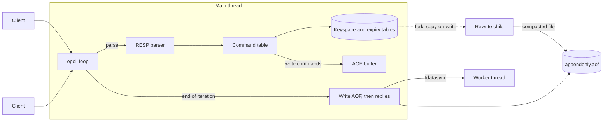

# kvstore

[](https://github.com/daen8584-spec/kvstore/actions/workflows/ci.yml)

An in-memory key-value server in C++20 that speaks the Redis protocol, so existing Redis clients, `redis-cli` and `redis-benchmark` work with it unchanged. It implements the core of what makes Redis fast and reliable: a single-threaded event loop with pipelining and backpressure, a hash table that resizes incrementally, key expiry, and append-only file persistence with configurable fsync and compaction in a forked child.

Its behaviour is checked against Redis itself: the protocol and command tests pass against both kvstore and Redis. Without pipelining, its throughput is 0.86 to 1.18 times that of Redis on the same machine, measured on x86-64 against Redis 7.0 and on ARM against Redis 8.10.

## Features

- **Redis protocol (RESP2)**, including pipelining and inline commands, with limits on request sizes
- **Strings, lists, hashes and sorted sets**: 61 commands, including `SET` with all its options, `SCAN` with `MATCH`, `COUNT` and `TYPE`, `EXPIRE` with `NX`, `XX`, `GT` and `LT`, and `ZADD` and `ZRANGE` with their option sets
- **Sorted sets** on a skip list with ranked links, giving O(log n) rank, range and count queries
- **Single-threaded epoll event loop** with no locks on the data path, fair reading across clients and backpressure for clients that do not read their replies
- **Incremental rehashing**: a resize is spread over many operations instead of stalling one request, and keys are hashed with SipHash-1-3 and a random key against hash flooding
- **Expiry** on access and by Redis-style random sampling, stored as absolute times so it survives restarts
- **Append-only file persistence** with `always`, `everysec` and `no` fsync policies, syncs on a worker thread, no acknowledgement and a `MISCONF` error for writes while the disk is full, recovery from a truncated tail, and compaction in a forked child while the server keeps serving
- **Verified** with unit and integration tests, the same integration tests run against Redis, AddressSanitizer and UndefinedBehaviorSanitizer, and two minutes of fuzzing on every push

## Results

Measured on 2026-11-05 with `bench/compare.py`: `redis-benchmark` with 50 clients, 500,000 requests per test and 64-byte values, against kvstore and Redis 7.0.15 on the same machine, a Linux VM with 2 vCPUs (Intel Xeon, 2.1 GHz). Throughput is in requests per second; the ratio is kvstore divided by Redis.

**No persistence**

| Test | Redis | kvstore | Ratio | Redis, pipeline 16 | kvstore, pipeline 16 | Ratio |
| --- | ---: | ---: | ---: | ---: | ---: | ---: |
| SET | 115,714 | 111,136 | 0.96 | 564,972 | 549,451 | 0.97 |
| GET | 119,446 | 119,190 | 1.00 | 718,391 | 818,331 | 1.14 |
| INCR | 115,075 | 118,483 | 1.03 | 807,754 | 803,859 | 1.00 |
| LPUSH | 103,691 | 105,731 | 1.02 | 1,201,923 | 1,420,454 | 1.18 |
| LPOP | 89,928 | 105,887 | 1.18 | 1,213,592 | 1,457,726 | 1.20 |
| HSET | 106,225 | 116,850 | 1.10 | 726,744 | 634,518 | 0.87 |

**Append-only file with `appendfsync everysec`**

| Test | Redis | kvstore | Ratio | Redis, pipeline 16 | kvstore, pipeline 16 | Ratio |
| --- | ---: | ---: | ---: | ---: | ---: | ---: |
| SET | 109,938 | 120,978 | 1.10 | 441,696 | 477,555 | 1.08 |
| GET | 119,417 | 118,147 | 0.99 | 719,424 | 836,120 | 1.16 |
| INCR | 120,308 | 116,198 | 0.97 | 628,931 | 692,521 | 1.10 |
| LPUSH | 108,648 | 108,155 | 1.00 | 705,219 | 1,046,025 | 1.48 |
| LPOP | 109,194 | 112,385 | 1.03 | 883,392 | 1,131,222 | 1.28 |
| HSET | 125,597 | 115,128 | 0.92 | 445,633 | 674,764 | 1.51 |

Without pipelining both servers are limited by system calls and network round trips, and for these commands kvstore is between 8% behind Redis and 18% ahead; sorted sets are measured separately below. With pipelining the differences grow in both directions. The higher numbers for lists and hashes are a trade-off rather than a better design: Redis stores small lists and hashes in compact encodings that save memory at some cost in speed, while kvstore uses general-purpose containers (`std::deque` and its own hash table) and uses more memory for them. With only 2 vCPUs, `redis-benchmark` competes with the server for CPU, so differences of a few percent are within run-to-run variation. Median latency without pipelining is 0.21 to 0.26 ms for both servers; the full results, including p99, are printed by the script.

### ARM tablet

Measured on 2026-11-05 on an Android tablet (MediaTek, four 2.2 GHz and four 3.2 to 3.35 GHz cores) under Termux, against Redis 8.10.3 from the Termux packages: 200,000 requests per test, 50 clients and 64-byte values, without persistence. Both servers ran on the fastest core and `redis-benchmark` on three other fast cores. Each figure is the median of 5 runs, alternating between the servers.

| Test | Redis | kvstore | Ratio | Redis, pipeline 16 | kvstore, pipeline 16 | Ratio |
| --- | ---: | ---: | ---: | ---: | ---: | ---: |
| SET | 68,213 | 79,523 | 1.17 | 343,643 | 469,484 | 1.37 |
| GET | 73,638 | 77,730 | 1.06 | 419,287 | 662,252 | 1.58 |
| INCR | 77,912 | 73,746 | 0.95 | 404,040 | 584,795 | 1.45 |
| LPUSH | 75,443 | 73,421 | 0.97 | 320,000 | 704,225 | 2.20 |
| LPOP | 80,096 | 69,037 | 0.86 | 356,506 | 743,494 | 2.09 |
| HSET | 71,250 | 73,883 | 1.04 | 253,807 | 501,253 | 1.97 |

Pinning was necessary. Without it, identical runs differed by more than a factor of two for both servers, depending on which cores the scheduler chose. Without pipelining, the results match the x86-64 machine: the two servers are within about 15% of each other. With pipelining, system call costs are shared across 16 commands and per-command work dominates. Here kvstore does less than Redis 8: it has no access control checks, per-command statistics and latency histograms, keyspace notifications or compact encodings. That, rather than a faster design, is the likely reason for its lead. Build differences in the Termux package of Redis may also contribute; they were not investigated.

### Sorted sets

Measured on the x86-64 machine with the same settings, median of 3 runs. `ZADD` uses random scores over up to 100,000 members of one sorted set, so most calls move an existing member to a new position.

| Test | Redis | kvstore | Ratio | Redis, pipeline 16 | kvstore, pipeline 16 | Ratio |
| --- | ---: | ---: | ---: | ---: | ---: | ---: |
| ZADD | 117,897 | 105,175 | 0.89 | 408,163 | 367,918 | 0.90 |
| ZPOPMIN | 112,892 | 114,705 | 1.02 | 1,440,922 | 1,408,451 | 0.98 |

A sorted set with one member takes about 470 bytes of memory including its key, measured as the server's resident memory over 100,000 such sets.

The first version of `ZADD` reached 0.70 of Redis (0.55 with pipelining). Allocating each skip list node in one block, sharing the member string with the hash table, relinking nodes instead of reallocating them, and looking each member up once closed most of the gap; see [0007](docs/adr/0007-sorted-sets.md).

Correctness is checked the same way: the protocol and command integration tests, including 12 for sorted sets, pass against kvstore and Redis 7.0.15. The tests that existed before sorted sets were added also pass against Redis 8.10.3; the sorted set tests have not been run against Redis 8.

## Architecture



Each loop iteration reads from ready clients, executes every complete command in their buffers, and queues replies. At the end of the iteration the write commands are appended to the file, and only then are replies sent. A client never sees a success for a write that has not reached the append-only file, and with `appendfsync always` not before it is on disk.

## Design decisions

Documented as [Architecture Decision Records](docs/adr/README.md):

- [0002](docs/adr/0002-single-threaded-event-loop.md) One epoll event loop, replies after the AOF write, and backpressure
- [0003](docs/adr/0003-incremental-rehashing.md) Incremental rehashing, reverse-binary `SCAN` cursors and SipHash
- [0004](docs/adr/0004-expiry.md) Absolute expiry times with lazy and sampled expiry
- [0005](docs/adr/0005-append-only-file.md) Append-only file, fsync policies, crash recovery and fork-based compaction
- [0006](docs/adr/0006-verification.md) Testing against Redis, sanitizers and fuzzing
- [0007](docs/adr/0007-sorted-sets.md) Sorted sets on a hash table and a ranked skip list

## Commands

| Group | Commands |
| --- | --- |
| Strings | `GET` `SET` (`EX` `PX` `EXAT` `PXAT` `NX` `XX` `KEEPTTL` `GET`) `MGET` `MSET` `INCR` `INCRBY` `DECR` `DECRBY` `APPEND` `STRLEN` |
| Lists | `LPUSH` `RPUSH` `LPOP` `RPOP` (with count) `LLEN` `LRANGE` |
| Hashes | `HSET` `HGET` `HDEL` `HGETALL` `HLEN` `HEXISTS` |
| Sorted sets | `ZADD` (`NX` `XX` `GT` `LT` `CH` `INCR`) `ZINCRBY` `ZSCORE` `ZCARD` `ZREM` `ZRANK` `ZREVRANK` `ZRANGE` (`BYSCORE` `REV` `LIMIT` `WITHSCORES`) `ZREVRANGE` `ZRANGEBYSCORE` `ZREVRANGEBYSCORE` `ZCOUNT` `ZPOPMIN` `ZPOPMAX` |
| Keys | `DEL` `UNLINK` `EXISTS` `TYPE` `KEYS` `SCAN` `EXPIRE` `PEXPIRE` `EXPIREAT` `PEXPIREAT` `TTL` `PTTL` `PERSIST` |
| Server | `PING` `ECHO` `QUIT` `SELECT 0` `DBSIZE` `FLUSHALL` `FLUSHDB` `INFO` `CONFIG GET` `COMMAND` `TIME` `BGREWRITEAOF` |

Replies and error messages follow Redis, including `WRONGTYPE` errors and the reply types for missing keys.

## Building and running

Requirements: a C++20 compiler (GCC 11 or Clang 14 or later), CMake 3.20 or later, and Linux or Android.

```bash
git clone https://github.com/daen8584-spec/kvstore.git
cd kvstore
cmake -S . -B build -DCMAKE_BUILD_TYPE=Release
cmake --build build
./build/kvstore --port 6379 --appendonly yes --dir ./data
```

```bash
redis-cli -p 6379 SET greeting hello EX 60
redis-cli -p 6379 GET greeting
```

### With Docker

```bash
docker compose up -d --build
redis-cli -p 6379 PING
```

The container runs with persistence enabled and stores its append-only file in the `kvstore-data` volume. The port is published on `127.0.0.1` only. CI builds the image, starts it, and checks that data survives a container restart.

### Options

| Option | Default | Description |
| --- | --- | --- |
| `--bind` | `127.0.0.1` | IPv4 address to listen on |
| `--port` | `6379` | TCP port |
| `--dir` | `.` | Directory for the append-only file |
| `--appendonly` | `no` | Enable persistence |
| `--appendfilename` | `appendonly.aof` | Append-only file name |
| `--appendfsync` | `everysec` | `always`, `everysec` or `no` |
| `--auto-aof-rewrite-percentage` | `100` | Rewrite after this much growth since the last rewrite; `0` disables |
| `--auto-aof-rewrite-min-size` | `67108864` | Minimum file size for an automatic rewrite, in bytes |
| `--maxclients` | `10000` | Connections beyond this are rejected with an error |
| `--hz` | `10` | Frequency of background tasks per second |
| `--proto-max-bulk-len` | `536870912` | Largest accepted string, in bytes |
| `--loglevel` | `info` | `debug`, `info`, `warning` or `error` |

The server has no authentication. It listens on the loopback interface by default and should not be exposed to untrusted networks.

### Persistence guarantees

| `appendfsync` | A process crash loses | A power failure loses |
| --- | --- | --- |
| `always` | nothing acknowledged | nothing acknowledged |
| `everysec` | nothing acknowledged | about the last second of writes |
| `no` | nothing acknowledged | whatever the operating system had not flushed |

A process crash cannot lose acknowledged writes under any policy, because replies are sent only after the write reaches the file. On startup, a command cut off at the end of the file is discarded and the file truncated, while damage elsewhere stops the server with the offset of the problem.

## Testing

```bash
ctest --test-dir build --output-on-failure        # unit tests and fuzz corpus
cd tests/integration && python3 -m pytest          # end-to-end tests against the binary
KVSTORE_TARGET=redis python3 -m pytest             # the same tests against redis-server
```

Integration tests need Python 3 with pytest. They start the server on a free port per test and talk RESP over TCP with a minimal client in `tests/integration/resp_client.py`, so they control exactly what is sent. They cover partial requests delivered one byte at a time, 10,000 pipelined commands, an 8 MiB binary value, a client that requests 100 MiB of replies before reading any, concurrent clients, protocol errors, expiry with and without access, `SCAN` completeness, and persistence: restart, `SIGKILL` recovery, truncated and corrupted files, and writes made during a rewrite.

Sanitizer and fuzzing builds:

```bash
cmake -S . -B build-asan -DCMAKE_BUILD_TYPE=Debug -DKV_SANITIZE=ON && cmake --build build-asan
cmake -S . -B build-fuzz -DCMAKE_CXX_COMPILER=clang++ -DKV_FUZZ=ON && cmake --build build-fuzz --target fuzz_resp
./build-fuzz/fuzz_resp fuzz/corpus -max_total_time=60
```

CI builds with GCC and Clang with warnings as errors, runs all tests normally and under sanitizers, runs the integration tests against Redis, fuzzes for two minutes and checks formatting on every push.

## Benchmarks

```bash
python3 bench/compare.py --binary build/kvstore --requests 500000 --persistence none
python3 bench/compare.py --binary build/kvstore --requests 500000 --persistence everysec
```

The script starts kvstore and `redis-server` with the same settings, runs `redis-benchmark` against each in turn, and prints a comparison table. It needs `redis-server` and `redis-benchmark` on the `PATH`.

On processors with cores of different speeds, such as phones and tablets, the scheduler can move either server between slow and fast cores from one test to the next, and single runs differ by a factor of two or more. Pin both servers to one fast core and the benchmark client to others, and repeat each test to report the median:

```bash
python3 bench/compare.py --binary build/kvstore --server-cpu 7 --client-cpus 4,5,6 --repeat 5
```

## Project structure

```
src/
  main.cpp        Command-line options and startup
  server.*        Event loop, connections, backpressure, INFO and CONFIG
  commands.*      Command table and implementations
  database.*      Keyspace, expiry tables, lazy and active expiry
  dict.hpp        Hash table with incremental rehashing and SCAN cursors
  zset.*          Sorted sets: ranked skip list and score parsing
  aof.*           Append-only file, background syncs, loading and rewriting
  resp.*          Incremental request parser and reply encoding
  siphash.*       SipHash-1-3 and SipHash-2-4
  glob.*          Glob matching for KEYS and SCAN
  log.*           Logging
tests/
  unit/           Unit tests (C++)
  integration/    End-to-end tests (Python, pytest)
fuzz/             libFuzzer target and seed corpus
bench/            Benchmark comparison with redis-server
docs/adr/         Architecture Decision Records
```

## Limitations

- One database (`SELECT 0` only), RESP2 only, and IPv4 only.
- Not implemented: sets, lexicographic sorted set ranges (`BYLEX`), transactions, publish and subscribe, scripting, replication, clustering, memory limits with eviction, snapshots (RDB) and authentication.
- Memory is not reported in `INFO`, because the server does not use an instrumented allocator.

## License

[MIT](LICENSE)
